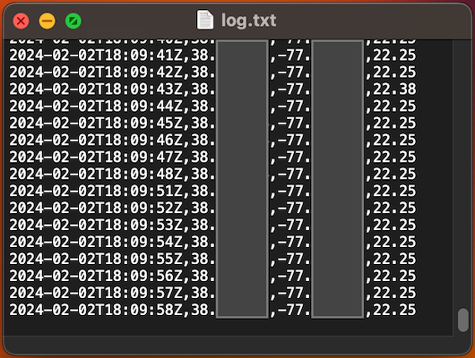

# Mobile logger for community science urban heat island mapping

## Adafruit Feather RP2040 Adalogger

### Component list

## Core items
| Item  | Link |
| ------------- | ------------- |
| Adafruit Feather RP2040 Adalogger | $14.95 [from Adafruit](https://www.adafruit.com/product/5980) |
| Adafruit Mini GPS PA1010D - UART and I2C - STEMMA QT | $29.95 [from Adafruit](https://www.adafruit.com/product/4415) |
| Adafruit Sensirion SHT45 Temperature & Humidity Sensor - STEMMA QT / Qwiic (with PTFE filter) | $13.50 [from Adafruit](https://www.adafruit.com/product/5665) |
| QT to QT Cable - 200mm | $1.25 [from Adafruit](https://www.adafruit.com/product/4401) |
| QT to QT Cable - 100mm | $0.95 [from Adafruit](https://www.adafruit.com/product/4210) |
| Breadboard-friendly RGB Smart NeoPixel | 5 for $7.95 [from Adafruit](https://www.adafruit.com/product/1312) or 25 for $24.95 [from Adafruit](https://www.adafruit.com/product/1558) |
| Solid-Core Wire - 22AWG | $2.95 for 25ft [from Adafruit](https://www.adafruit.com/product/290) |
| MicroSD Memory Card - 8GB | $10-20 |
| USB C to USB C Cable - 1m | $9.95 [from Adafruit](https://www.adafruit.com/product/4199) |
| Power bank w/ USB-C port | [⚠️TODO: recommended capacity and example source] |
| screws (4pcs M2*20mm, 16pcs M2x8mm), 28pcs washers, 28pcs nuts | |
| 1/4"-20 thread size, 1/2" installed length Heat-Set Threaded Inset | 10 for $12.14 [from McMaster-Carr](https://www.mcmaster.com/94459A717/) |
| 4pcs M2 x 0.4 mm thread size, 2.5 mm installed length Heat-Set Threaded Inset | 50 for $9.73 [from McMaster-Carr]() |

**General notes:**  
- If buying from Adafruit they offer discounts when buying quantities greater than 10.
- To save $8 you can replace the SHT45 Sensor with the SHT41 ([$5.95 from Adafruit](https://www.adafruit.com/product/5776)). The same code will work for both.
    - The SHT41 has an ±1.8% typical relative humidity accuracy from 25 to 75% and ±0.2 °C typical accuracy from 0 to 75 °C.
    - The SHT45 has an ±1.0% typical relative humidity accuracy from 25 to 75% and ±0.1°C typical accuracy from 0 to 75 °C. Also, the SHT45 has the optional PTFE filter membrane that provides an additional barrier for all pollutants to enter the sensor opening, thus lowering negative influences on the sensing element. The membrane has a thickness of 100 µm offering a filtration efficiency of >99.99% for particles of 200 nm size and larger. Owing to the high permeability and the small volume between sensing element and membrane, the specified response time of the RH sensor is unaltered. 
- You can buy 3 colors of wire - red, black, white for power, ground, and data - but it is not required.
    - ⚠️TODO: Estimate how much wire each unit uses.

**Tools:**
- Solder wire - such as: Standard 60/40 lead/tin Rosin Core Solder which is easy to work with - $7.95 [from Adafruit](https://www.adafruit.com/product/1886).
    - **🚨 WARNING:** [Lead is a toxic metal](https://www.who.int/news-room/fact-sheets/detail/lead-poisoning-and-health) that can cause serious health problems. Work in a well ventilated area, avoid ingesting, keep away from children, and take proper precautions when working with materials containing lead. There is also [lead free solder](https://www.adafruit.com/product/1930) available.
- Soldering iron ([this guide](https://learn.adafruit.com/adafruit-guide-excellent-soldering) has notes on choosing an iron).
- Safety glasses.
- Tweezers.
- Snips.

### Setup

- Print & assemble the case.
    - ⚠️TODO: More details here.
    - **🚧 UNDER DEVELOPMENT** : We are designing a case that can be used either over the top of a car window or screwed onto any mount with a 1/4" threaded bolt (with only the swap of a base piece), but the design is not finalized.
- Solder the NeoPixel to the Adalogger board. If you're new to soldering, consider looking through the [Adafruit Guide To Excellent Soldering](https://learn.adafruit.com/adafruit-guide-excellent-soldering) by Bill Earl.
    - All the wires should connect to the same side of the NeoPixel:
        - `GND` on the board <--> `G` on the NeoPixel (black wire)
        - `9` on the board <--> `In` on the NeoPixel (white wire)
        - `USB` on the board <--> `+` on the NeoPixel (red wire)
    - ⚠️TODO: Add wire length recommendations. Add details about printing/using the template for soldering.
- [Install the Mu editor](https://learn.adafruit.com/welcome-to-circuitpython/installing-mu-editor) on your computer. 
- [Install CircuitPython](https://learn.adafruit.com/adafruit-feather-rp2040-adalogger/install-circuitpython) on the Adalogger board. 
    - When downloading the latest stable version of [CircuitPython for the Adalogger](https://circuitpython.org/board/adafruit_feather_rp2040_adalogger/) note the version number. 
    - The project has been tested using `10.2.1` which can be downloaded here: [adafruit-circuitpython-adafruit_feather_rp2040_adalogger-en_US-10.2.1.uf2](https://adafruit-circuit-python.s3.amazonaws.com/bin/adafruit_feather_rp2040_adalogger/en_US/adafruit-circuitpython-adafruit_feather_rp2040_adalogger-en_US-10.2.1.uf2).
    - **Note:** One of the steps requires pressing the 2 buttons on the board which is easier to do now rather than after everything is assembled.
- Make sure the `CIRCUITPY` drive that shows up on your computer contains a `/lib/` folder and `/sd/` folder.
- Download the CircuitPython [library bundle](https://circuitpython.org/libraries) for your CircuitPython version. Match the version with the version of CircuitPython you installed. We installed `10.2.1` so looked for "Bundle for Version 10.x".
- Unzip the library download, and from the `/lib/` folders copy the following files into the `/lib/` folder on your board's drive:
    - adafruit_gps.mpy
    - adafruit_sht4x.mpy
    - neopixel.mpy
- To check your soldering, copy the `code_Adalogger-NeoPixel-Test.py` file to the home directory of the board and rename it to just `code.py`. The NeoPixel should turn on/off every 2 seconds.
- Delete the `code.py` file from the board. Copy the `code_Adalogger-NeoPixel.py` file from this repository to the home directory of the Metro board and rename it to just `code.py`.
- Unplug the board from your computer.
- Insert the SD card into the slot on the end of the Adalogger board.
- Connect the SHT41/45 Sensor to the 200mm QT cable. The cable should plug into the left side of the sensor when the sensor is oriented so that you can read the text printed on it.
- Run the cable down into the case from the radiation shield.
- Secure the SHT Sensor using 4 M2*8mm screws, nuts, and washers.
- Connect the QT cable to the right side of the Mini GPS when the GPS is oriented so that you can read the text printed on it.
- Connect the 100mm QT cable to the Mini GPS. Plug the cable into the left side of the Mini GPS when the GPS is oriented so that you can read the text printed on it.
- M2*20mm

#### Running things

If the device is powered on and can get a GPS fix it will start logging a line every 1 second with the timestamp, geographic coordinates, temperature and humidity. **NOTE:** You'll need to remove the SD card from the board and plug it into your computer to edit or delete the files. If you connect to your computer via the board's USB port, you can copy the files but will have read-only access.

  
_(An example of the type of data file output.)_

#### Troubleshooting
- **Safe mode** _(the following is an excerpt from the [Adafruit documentation](https://learn.adafruit.com/adafruit-feather-rp2040-adalogger/install-circuitpython#safe-mode-3097754))_ 
    - If you find that you can't edit the `code.py` file on your board or otherwise modify the files on the CIRCUITPY drive, it may help to enter safe mode. Safe mode in CircuitPython does not run any user code on startup, and disables auto-reload. Plug in the board or press Reset in the first 1000ms - think of it simply as a slow double click of the reset button. Remember, a fast double click of reset enters the bootloader. Your code will not run until you press the reset button, or unplug and plug in your board, to get out of safe mode. 

#### Additional reading and resources

- Guide for the [Adafruit Feather RP2040 Adalogger](https://learn.adafruit.com/adafruit-feather-rp2040-adalogger) by Liz Clark
- Guide for the [Adafruit Sensirion SHT40, SHT41 & SHT45 Temperature & Humidity Sensors](https://learn.adafruit.com/adafruit-sht40-temperature-humidity-sensor/overview) by Kattni Rembor
- Guide for the [Adafruit Ultimate GPS](https://learn.adafruit.com/adafruit-ultimate-gps) by lady ada 
- API technical documentation for the [Adafruit GPS library](https://docs.circuitpython.org/projects/gps/en/latest/index.html) 
- [Welcome to CircuitPython!](https://learn.adafruit.com/welcome-to-circuitpython) by Adam Bachman 
- [Adafruit's CircuitPython mode sheet](https://learn.adafruit.com/mu-keyboard-shortcut-cheat-sheets#circuitpython-mode-cheat-sheet-3011142) for the Mu editor
- Documentation for [Adafruit CircuitPython](https://docs.circuitpython.org) 
